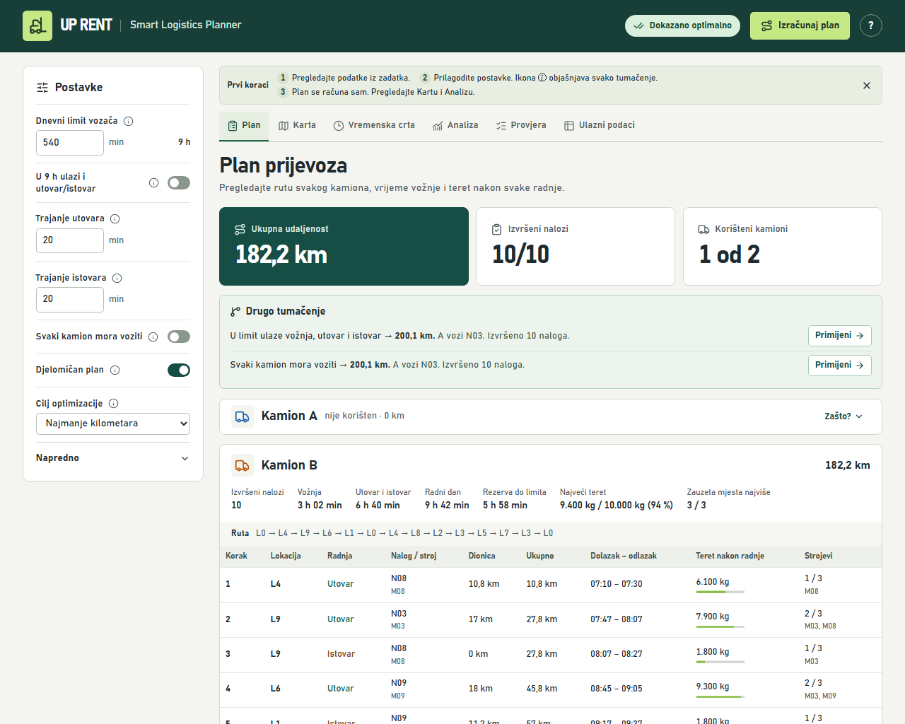

# UP RENT – Smart Logistics Planner

Web-aplikacija koja transportne naloge raspoređuje na kamione, određuje redoslijed utovara i istovara te traži raspored s najmanje prijeđenih kilometara. Pritom poštuje nosivost i broj strojeva u svakom trenutku, dnevni limit vozača i povratak u bazu. Za podatke iz zadatka plan je **dokazano optimalan**.

**[Otvori javni demo](https://uprent-smart-logistics-planner.lovre-petrina2.workers.dev/)** · Nakon 15 minuta neaktivnosti prvo otvaranje može potrajati dok se kontejner pokrene.

## Brzi početak

Treba samo [uv](https://docs.astral.sh/uv/getting-started/installation/) (sam instalira Python 3.11 i ovisnosti). Node nije potreban jer je sučelje već izgrađeno.

```
uv sync
uv run uprent serve
```

Otvori **http://127.0.0.1:8000**. Plan za podatke iz zadatka izračuna se sam.

## Kroz aplikaciju u jednoj minuti

1. **Plan** – ukupni km, raspored po kamionu i tablica svakog koraka: lokacija, radnja, teret nakon radnje i satnica.
2. **Postavke** (lijevo) – svako tumačenje iz zadatka može se promijeniti, a ⓘ objašnjava što mijenja. Kad drugo tumačenje daje drukčiji egzaktni rezultat, možete ga primijeniti jednim klikom. Za sporije izračune usporedbu pokrećete gumbom.
3. **Ulazni podaci** – pregled i uređivanje lokacija, strojeva, kamiona i naloga. Nalog koji se ne može izvršiti dobiva jasno upozorenje s razlogom.
4. **Karta**, **Vremenska crta**, **Analiza** (zašto je plan takav i što ako) i **Provjera** (neovisna provjera svakog pravila).

## Rezultat za podatke iz zadatka

| Tumačenje | Ukupno | Raspored |
|---|---|---|
| Zadano: 9 h se odnosi na vožnju, kamion smije ostati u bazi | **182,2 km** | sve vozi B (vožnja 3 h 02 min, s utovarom i istovarom 9 h 42 min); A ostaje u bazi |
| U 9 h ulazi i utovar/istovar (ili: oba kamiona moraju voziti) | **200,1 km** | A vozi N03 (37,2 km), B ostalih 9 naloga (162,9 km, 8 h 43 min) |

Obrazloženje tumačenja: `docs/PRETPOSTAVKE.md`.



## Naredbeni redak

```
uv run uprent solve data/default_scenario.json
uv run uprent solve data/default_scenario.json --set limit_includes_handling=true
uv run uprent compare data/default_scenario.json
```

## Testovi

```
uv run pytest
```

Za testove sučelja koristite Node 24. U mapi `web` pokrenite

```
npm ci
npm test
npx playwright install chromium
npm run e2e
```

## Kako radi (ukratko)

- **Egzaktni solver** dinamičkim programiranjem dokazuje optimum. Automatski se bira za scenarije do 12 naloga i 3 kamiona.
- **OR-Tools** traži najbolji plan u zadanom vremenu. Preuzima veće ulaze i izračune u kojima egzaktni solver dosegne sigurnosnu granicu broja stanja ili vremena.
- **Neovisni validator** ponovno simulira svaki plan radnju po radnju i daje sve brojke koje se prikazuju. Plan koji ne prođe validator nikad se ne prikazuje kao valjan.

Detaljnije: `docs/LOGIKA.md`.

## Dokumentacija

| Dokument | Sadržaj |
|---|---|
| `docs/upute.md` | upute za korištenje i kako dijelovi rade zajedno |
| `docs/LOGIKA.md` | opis optimizacijske logike |
| `docs/PRETPOSTAVKE.md` | dvosmislena mjesta u zadatku, tumačenja i njihov učinak |
| `docs/AI_ALATI.md` | korišteni AI alati i način provjere njihovih rezultata |
| `docs/VRIJEME.md` | procjena stvarnog vremena razvoja |
| `docs/deploy.md` | Docker i Cloudflare |
| `docs/razvoj/` | specifikacija, plan implementacije, dnevnik provjera i plan zasebnog QA postupka |
