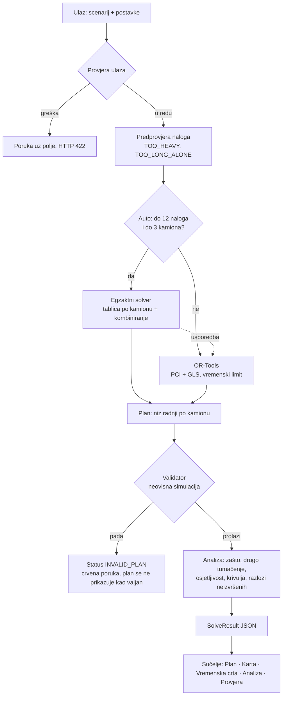

# UP RENT – Smart Logistics Planner: specifikacija

Verzija 4.2 · 22. 11. 2026 (ispravci nakon tri kruga neovisnog pregleda i Codexove početne provjere, vidi §19). Mjerodavni izvor je `originalni-zadatak.md`; ta datoteka postoji samo lokalno i u `.gitignore` je, jer nije potvrđeno smije li se objaviti. Ako se ova specifikacija i zadatak razilaze, vrijedi zadatak. Plan izrade je u `docs/razvoj/plan-implementacije.md`, a provjera kvalitete u `docs/razvoj/qa-plan.md`.

## 0. Ukratko

Gradimo web-aplikaciju (FastAPI + React) koja raspoređuje transportne naloge na kamione i određuje redoslijed utovara i istovara. Jezgra ima tri neovisna dijela:

- **Egzaktni solver** (dinamičko programiranje) za do 12 naloga i do 3 kamiona. Daje dokazani optimum i podatke za objašnjenja.
- **OR-Tools Routing** za veće ulaze. Daje dobar plan, ali bez dokaza optimalnosti.
- **Validator** ponovno simulira svaki plan radnju po radnju. On je jedini izvor brojki koje se prikazuju, i plan koji ne prođe validator nikad se ne prikazuje kao valjan.

Dvosmislena pravila iz zadatka su postavke. **Zadana vrijednost svake postavke je najočitije, doslovno tumačenje teksta zadatka.** Sučelje uz rezultat uvijek prikazuje i što bi dalo drugo tumačenje, s gumbom za primjenu.

Referentni rezultat sa zadanim postavkama: **182,2 km, 10/10 naloga, dokazano optimalno, sve vozi kamion B.** Uz strože tumačenje (u 9 h ulazi i utovar/istovar): **200,1 km, kamion A vozi N03.**

## 1. Svrha i kriteriji uspjeha

Zadatak ocjenjuje „kvalitetu logike, funkcionalnost, razumijevanje problema i samostalnost kandidata".

| Kriterij | Čime ga pokazujemo |
|---|---|
| Kvaliteta logike | egzaktni optimum s dokazom, OR-Tools za veće ulaze, neovisni validator |
| Funkcionalnost | web-aplikacija s pregledom i uređivanjem podataka, postavkama, planom po kamionu i upozorenjima (zahtjev 8); upute ugrađene u sučelje |
| Razumijevanje problema | postavke za dvosmislena pravila s vidljivim učinkom, prikaz drugog tumačenja, objašnjenje zašto je plan takav |
| Samostalnost | odluke s obrazloženjem (`docs/PRETPOSTAVKE.md`), neovisna provjera koda koji je pisao AI, dokumentirane greške AI alata |

Rad je uspješan kad:
1. su ispunjeni svi zahtjevi iz točaka 5, 6 i 8 zadatka;
2. svi referentni brojevi iz §15 prolaze kao automatski testovi;
3. novi korisnik bez čitanja dokumentacije u sučelju sam nađe kako izračunati plan, promijeniti tumačenje i dodati nalog;
4. kandidat svaku komponentu zna objasniti jednom rečenicom: što radi i zašto postoji.

## 2. Ciljevi, ne-ciljevi i anti-ciljevi

**Ciljevi**
- Ispravan i dokazano optimalan plan za zadane podatke; za izmijenjene podatke najbolji plan uz jasan status.
- Sve što traže točke 5 i 6 zadatka.
- Postavke za dvosmislena pravila, s doslovnim tumačenjem kao zadanim i vidljivim učinkom drugog tumačenja.
- Objašnjenja plana i usporedba scenarija („što ako").
- Sučelje koje vodi korisnika kroz upute ugrađene u dizajn.
- Sve stavke predaje iz točke 8 zadatka i javno dostupan demo.

**Ne-ciljevi**
- Stvarne ceste, geografske karte i vanjski API-ji (zadatak ih isključuje).
- Prijava korisnika, baza podataka i rad više korisnika; scenariji se spremaju kao JSON.
- Vremenski prozori kupaca, pauze vozača, više dana; to su sljedeći koraci.

**Anti-ciljevi** (neuspjeh čak i kad aplikacija „radi")
- Prikazati plan kao valjan iako krši neko pravilo.
- Napisati „optimalno" bez dokaza.
- Brojke u sučelju koje se razlikuju od brojki validatora.
- Pad aplikacije na neizvedivom ili neobičnom ulazu (stroj od 12.000 kg, nula naloga).
- Uputa koja se ne uklapa u dizajn ili blokira rad (modalni prozori koji iskaču sami).
- Dio sustava koji kandidat ne zna objasniti.

## 3. Tehnička ograničenja

- Python 3.11 preko `uv` (`.python-version` = 3.11; OR-Tools 9.15 provjeren na toj verziji). Ovisnosti: `fastapi`, `uvicorn`, `pydantic` (v2), `ortools` (9.15.x); razvoj: `pytest`, `httpx`, `hypothesis`.
- Sučelje: React 18 + TypeScript + Vite + Tailwind CSS, ikone `lucide-react`; grafovi i karta kao vlastiti SVG (bez biblioteka za karte). Node 24 služi samo za izgradnju.
- Izgrađeno sučelje (`web/dist`) commita se u repozitorij i poslužuje ga FastAPI. Za lokalno pokretanje ocjenjivaču trebaju samo `uv` i Python.
- Identifikatori u kodu su na engleskom; sav tekst u sučelju i dokumentaciji na hrvatskom.
- Git i GitHub: repozitorij `uprent-smart-logistics-planner`, privatan tijekom razvoja, a javan pri predaji (odluka vlasnika). Commitovi su česti i smisleni, pa povijest pokazuje razvoj: specifikacija → testovi → kod. CI (GitHub Actions) pokreće testove na svaki push.
- Hosting: vidi §14.

## 4. Razmotreni pristupi i odabir

| | A: OR-Tools + Streamlit | B: OR-Tools + FastAPI + React | **C: hibrid (odabran)** |
|---|---|---|---|
| Izvor | prvi prijedlog ChatGPT-a | Gemini | konsolidacija sva tri |
| Optimizacija | heuristika, bez dokaza | heuristika, bez dokaza | egzaktno do 12 naloga, OR-Tools iznad |
| Provjera | validator | validator | validator + usporedba dvaju neovisnih solvera + neovisni referentni solver u QA |
| Sučelje | Streamlit | React | React, posluženo iz FastAPI-ja |
| Mana | slabiji dojam web-aplikacije; nema dokaza | nema dokaza; predloženi `AddDisjunction` ruši proces | najviše posla |

Izmjereno, ne pretpostavljeno:
- Ispravno postavljen OR-Tools (limit 2 s) pogodio je optimum na 15 od 16 slučajnih ulaza s 10–12 naloga; jednom je bio 0,31 % lošiji (295,6 umjesto 294,7 km).
- Egzaktni solver raste otprilike 2,7 puta po nalogu: 10 naloga ~0,2 s, 12 ~2 s, 13 5–7 s (čisti Python). OR-Tools je za 40 naloga i 4 kamiona dao valjan plan za 3 s.
- Svaki plan oba solvera prošao je neovisnu provjeru.

## 5. Fiksna poslovna pravila (nisu postavke)

1. Svaki kamion koji vozi kreće iz baze (L0) i vraća se u bazu prazan. Kamion bez naloga ostaje u bazi (0 km).
2. Nakon svake radnje: masa tereta ≤ nosivosti i broj strojeva ≤ broju mjesta. Jednakost je dopuštena.
3. Utovar prethodi istovaru i oba izvodi isti kamion; istovariti se smije samo stroj koji je u kamionu.
4. Svaki uključeni nalog ima točno jedan utovar i jedan istovar; izostavljeni nalog nema nijednu radnju i navodi se u upozorenjima.
5. Udaljenost je euklidska; svaka dionica zaokružuje se na 0,1 km, polovica prema gore. Interno se računa u cijelim desetinkama kilometra.
6. Između dviju radnji na istoj lokaciji je 0 km, ali svaka radnja traje svoje vrijeme. Redoslijed radnji na istoj lokaciji je bitan (npr. na L7 B prvo istovaruje M06 pa utovaruje M10; obrnuto bi na trenutak bilo 13.300 kg).
7. Radnje u bazi (utovar M05 za N05, istovar M04 za N04) prave su radnje i traju kao i ostale.
8. Jedan stroj smije biti u najviše jednom nalogu (inače bi trebala vremenska ovisnost između naloga, što je izvan opsega). Takav ulaz odbija se porukom.
9. Vrijeme se računa i uspoređuje u racionalnoj aritmetici (`fractions.Fraction`, sekunde), nikad u `float`: vožnja = desetinke km × 360 / brzina_kmh. Pri 60 km/h desetinka km traje točno 6 s. Uspoređuje se `<=`.
10. Trajanje radnje upisano na nalogu ima prednost pred globalnom postavkom. Promjena globalne postavke ne mijenja vrijednosti upisane na nalozima.

## 6. Postavke i zadane vrijednosti

**Načelo (odluka kandidata):** zadano je najočitije, doslovno tumačenje teksta. Gdje tekst nešto ne traži, zadano je da se to ne traži. Svaka takva postavka u sučelju ima objašnjenje, a uz rezultat se prikazuje što bi dalo drugo tumačenje.

| Ključ | Naziv u sučelju | Zadano | Obrazloženje zadanog |
|---|---|---|---|
| `day_limit_min` | Dnevni limit vozača | 540 (9 h) | „vozač može voziti 9h dnevno" |
| `limit_includes_handling` | U 9 h ulazi i utovar/istovar | **ne** | Tekst kaže „voziti"; ne kaže da se u limit računa utovar/istovar. |
| `load_min`, `unload_min` | Trajanje utovara / istovara | 20 / 20 min, po radnji | „prosječno na utovar/istovar troši 20 minuta"; čita se kao svaka radnja. Tumačenje „20 min po nalogu" = 10 + 10. Može se zadati i po nalogu. |
| (po kamionu) `speed_kmh` | Brzina | 60 km/h | zadatak |
| `require_all_trucks` | Svaki kamion mora voziti | **ne** | Tekst ne traži da oba kamiona voze; „Oba kamiona polaze iz baze i moraju se vratiti u bazu" opisuje početak i kraj rute. |
| `allow_partial` | Djelomičan plan | da | Zahtjev 8: izvrši što se može i jasno upozori za ostalo. |
| `objective` | Cilj | `km` | „smanjiti ukupnu prijeđenu udaljenost"; druga vrijednost: `makespan` (najraniji završetak posljednjeg kamiona). |
| `solver` | Solver | `auto` | auto bira egzaktni do `exact_max_orders` (12) naloga i `exact_max_trucks` (3) kamiona |
| `ortools_time_limit_s` | Vrijeme pretrage OR-Toolsa | 3 s | |
| `compare_with_ortools` | Usporedi s OR-Toolsom | da | prikaz slaganja dvaju solvera |
| `day_start` | Početak smjene | 07:00 | samo za prikaz satnice; zadatak ga ne navodi |
| `pinned_orders` | (interno) | prazno | `{nalog: kamion}`: prikvačeni nalog smije voziti samo taj kamion, a ostali nalozi su slobodni. Sučelje ga koristi za klik na točku krivulje (prikvači sve naloge) i za „prikaži plan s ovim nalogom na drugom kamionu" (prikvači jedan nalog). Radi u oba solvera. Nalog prikvačen na kamion koji ga ne može nositi je greška ulaza; ako prikvačeni nalog ne stane u vrijeme, ostaje neizvršen s razlogom. |

Redoslijed ciljeva (leksikografski): (1) najviše izvršenih naloga; (2) ako je `require_all_trucks` uključeno, što više korištenih kamiona (meko pravilo: kad je nemoguće, plan se radi i prikazuje se upozorenje); (3) odabrani cilj; (4) km.

**Zašto je doslovno zadano sigurno:** na zadanim podacima B sam radi 9 h 42 min (vožnja 3 h 02 min + 20 radnji × 20 min). Ocjenjivač koji 9 h čita kao cijeli radni dan to bi mogao vidjeti kao prekršaj. Zato sučelje odmah ispod rezultata prikazuje traku „Drugo tumačenje: ako u 9 h ulazi i utovar/istovar → 200,1 km, A vozi N03 [Primijeni]" i ukupno radno vrijeme svakog kamiona. Oba tumačenja su vidljiva na prvom ekranu.

**Učinak postavki na zadanim podacima** (izračunato egzaktnim solverom; sve su to i testovi):

| Scenarij | Rezultat |
|---|---|
| Zadano | **182,2 km**, 10/10; A ostaje u bazi; B vozi 182,2 km (3 h 02 min), radnje 400 min, ukupno 582,2 min (9 h 42 min); najveći teret 9.400 kg, 3 stroja |
| U 9 h ulazi utovar/istovar | **200,1 km**; A: N03 (37,2 km, 77,2 min); B: 9 naloga (162,9 km, 522,9 min); najveći teret B 9.900 kg |
| Svaki kamion mora voziti | 200,1 km (isti plan) |
| Trajanje radnje 0–30 min (zadani način) | 182,2 km; mijenja se samo ukupno radno vrijeme jer radnje ne ulaze u limit |
| Limit vožnje 3 h (180 min) | 200,1 km |
| Limit vožnje 2 h 30 min | 239,2 km (A: N03, N05) |
| Limit vožnje 2 h 20 min | 9/10 naloga |
| Limit vožnje 1 h 40 min | 7/10 naloga |
| Uključeno „u 9 h ulazi utovar/istovar" + radnja 18–20 min | 200,1 km (do 17 min: 182,2 km) |
| … + radnja 21 min | 217,0 km (A: N01, N04) |
| … + radnja 25 / 30 min | 235,1 / 254,9 km |
| … + radni dan 8 h | 235,1 km |
| … + radni dan 5 h 30 min | 9/10 naloga |
| … + radni dan 5 h | 8/10, izostavljeni N08 i N09 |
| … + „20 min po nalogu" (10 + 10) | 182,2 km |
| Cilj „najraniji završetak" | 284,2 km (A: N01–N05, B: N06–N10); svi gotovi za 344,8 min (5 h 45 min) |
| Svaki kamion nosi 1 stroj odjednom | 209,0 km (zadano) / 226,0 km (uz uključeno „u 9 h ulazi utovar/istovar") |
| Granični slučaj: A vozi samo N04 | B tada radi 540,4 min (9 h 00 min 24 s): valjano u zadanom načinu, nevaljano kad u 9 h ulazi utovar/istovar |

## 7. Arhitektura i tok programa



Struktura repozitorija:

```
UpRent-zadatak/                  # korijen repozitorija
  originalni-zadatak.md          # samo lokalno, u .gitignore; ne mijenja se
  pyproject.toml · .python-version · uv.lock · .gitignore
  data/default_scenario.json     # podaci iz zadatka (već postoji; ugovor formata)
  src/uprent/
    domain.py        # Pydantic modeli i provjera ulaza
    distance.py      # dionice u desetinkama km, vrijeme vožnje
    plan.py          # Op, Plan (samo nizovi radnji)
    validator.py     # neovisna simulacija; vlastita formula udaljenosti; izvor svih prikazanih brojki
    precheck.py      # razlozi neizvedivosti prije optimizacije
    solvers/{exact,ortools_solver,auto}.py
    analysis.py      # zašto, drugo tumačenje, osjetljivost, krivulja km ↔ radni dan
    compare.py       # usporedba scenarija
    result.py        # SolveResult (shema odgovora)
    service.py       # solve(scenario) -> SolveResult (spaja sve gore)
    api.py · cli.py
  web/               # React + TS + Vite; build u web/dist (commita se)
  tests/             # pytest
  qa/oracle/         # neovisni referentni solver i usporedba (već postoji; aplikacija ga ne uvozi)
  cloudflare/        # Worker i konfiguracija za Cloudflare Containers
  docs/              # upute.md, LOGIKA.md, PRETPOSTAVKE.md, AI_ALATI.md, VRIJEME.md, razvoj/
  README.md
  priprema/          # lokalne bilješke; u .gitignore
```

## 8. Format podataka, CLI i API

**Scenarij (JSON)** – vidi `data/default_scenario.json`: `depot`, `locations[{id,name?,x,y}]`, `machines[{id,weight_kg}]`, `trucks[{id,name,capacity_kg,slots,speed_kmh}]`, `orders[{id,machine,pickup,delivery,load_min?,unload_min?}]`, `settings{…ključevi iz §6…}`.

**Provjera ulaza** vraća poruku na hrvatskom s nazivom polja za: nepoznatu lokaciju ili stroj, ponovljeni ID, isto mjesto utovara i istovara, isti stroj u dva naloga, masu ≤ 0, nosivost ≤ 0, broj mjesta < 1, brzinu ≤ 0, limit ≤ 0, trajanje radnje < 0, nepoznatu vrijednost postavke, prazan popis kamiona ili lokacija, `depot` koji nije među lokacijama, `day_start` koji nije u obliku HH:MM, `ortools_time_limit_s` izvan raspona 1–30, `pinned_orders` s nepoznatim nalogom ili kamionom, nalog prikvačen na kamion koji ga ne može nositi. Vrijednosti u `--set` i API-ju koje počinju s `{` ili `[` čitaju se kao JSON. Stroj teži od svih kamiona nije greška ulaza; takav nalog je neizvediv (zahtjev 8).

**CLI**
- `uprent solve PUTANJA [--json] [--solver auto|exact|ortools] [--set ključ=vrijednost …]` – ispisuje plan (tablica) ili `SolveResult` kao JSON. Izlazni kod 0; neispravan ulaz → izlazni kod 2 i poruka.
- `uprent compare PUTANJA` – tablica unaprijed zadanih varijanti (§12).
- `uprent serve [--host 127.0.0.1] [--port 8000]` – API i sučelje.

**API**

| Ruta | Što radi |
|---|---|
| `GET /api/health` | `{"status": "ok"}` |
| `GET /api/scenario/default` | zadani scenarij |
| `POST /api/solve` | `{scenario}` (postavke su u scenariju) → `SolveResult` |
| `POST /api/validate` | `{scenario, plan}` → izvještaj validatora |
| `POST /api/compare` | `{scenario, variants?}` → retci usporedbe |
| `/docs` | automatska OpenAPI dokumentacija |

**SolveResult** (skraćeno):

```json
{
  "status": "OPTIMAL | OPTIMAL_PARTIAL | FEASIBLE | FEASIBLE_PARTIAL | NO_FULL_PLAN | NOT_FOUND | INVALID_PLAN",
  "optimality": "proven | best_found | none",
  "solver": "exact | ortools",
  "settings": {},
  "totals": {"km": 182.2, "served": 10, "orders": 10, "trucks_used": 1},
  "trucks": [{
    "id": "B", "name": "Kamion B", "used": true, "km": 182.2,
    "drive_min": 182.2, "handling_min": 400, "total_min": 582.2,
    "limit_min": 540, "limit_basis": "drive", "slack_min": 357.8,
    "peak_kg": 9400, "capacity_kg": 10000, "peak_slots": 3, "slots": 3, "orders": ["N08", "..."],
    "steps": [{"seq": 1, "location": "L4", "action": "PICKUP", "order": "N08", "machine": "M08",
               "leg_km": 10.8, "cum_km": 10.8, "arrive": "07:10", "depart": "07:30",
               "load_kg": 6100, "load_slots": 1, "onboard": ["M08"]}]
  }],
  "unserved": [{"order": "N11", "reason": "TOO_HEAVY", "message": "…"}],
  "validation": {"passed": true, "checks": [{"rule": "kapacitet_kg", "passed": true, "detail": "najviše 9.400 / 10.000 kg (B)"}]},
  "analysis": {"why": [], "alternatives": [], "binding": [], "sensitivity": {}, "curve": []},
  "comparison": null,
  "messages": [],
  "timings_ms": {}
}
```

- Povratak u bazu je zadnji korak rute (`action: "RETURN"`). Kamion bez naloga ima `used: false` i prazne korake.
- `limit_basis` je `drive` ili `drive+handling`, prema postavci.
- Statusi: `OPTIMAL` i `OPTIMAL_PARTIAL` dolaze samo iz egzaktnog solvera; `FEASIBLE` i `FEASIBLE_PARTIAL` iz OR-Toolsa; `NO_FULL_PLAN` znači da je djelomičan plan isključen, a potpuni dokazano ne postoji (dokaz daje egzaktni solver ili predprovjera); `NOT_FOUND` znači da OR-Tools nije našao plan u zadanom vremenu; `INVALID_PLAN` znači da je solver vratio plan koji pada na nekoj **tvrdoj** provjeri validatora (greška u programu; prikazuje se crvena poruka).
- Kad se ne može izvršiti nijedan nalog, a djelomičan plan je dopušten, status je `OPTIMAL_PARTIAL` (egzaktni solver ili sama predprovjera) odnosno `FEASIBLE_PARTIAL` (OR-Tools), s porukom „Nijedan nalog nije moguće izvršiti.".
- `comparison` popunjava zaseban poziv (`solver=ortools`) koji sučelje radi nakon prikaza rezultata, da prvi rezultat stigne odmah.

## 9. Solveri

Svi solveri imaju isto sučelje i vraćaju samo **nizove radnji po kamionu** (`Plan`); sve brojke za prikaz računa validator.

`Plan` = po kamionu niz parova `(radnja, nalog)`, uz dva neobavezna polja koja popunjava servis iz izlaza solvera: `reported_km` (km koje solver tvrdi, po kamionu) i `reported_unserved` (nalozi koje solver nije uključio). Lokacije i strojevi se ne prenose: validator ih izvodi iz naloga, pa ne mogu biti pogrešni ni kod ručnog poziva `POST /api/validate`.

### 9.1 Egzaktni solver

**Korak 1: tablica za svaki kamion.** Dinamičko programiranje nad stanjima `(preuzeti, isporučeni, lokacija)` (bitmaske naloga). Iz stanja: utovar naloga koji još nije preuzet, ako masa i broj strojeva nakon utovara ostaju u granicama; ili istovar naloga koji je u kamionu. Za svako stanje pamti se najmanja kilometraža i prethodno stanje. Stanje bez tereta je završno: dodaje se povratak u bazu i upisuje `najbolje[S] = (km, radnje)` za skup isporučenih naloga S. Kamioni istog tipa (nosivost, mjesta) dijele tablicu.

Za zadani skup S vrijeme radnji je stalno, pa je ruta s najmanje km ujedno i najkraća po vremenu; jedna tablica služi za sve postavke vremena.

**Korak 2: kombiniranje.** Za cilj `km`: DP po podskupovima, `f_j(U) = min po S ⊆ U od (ključ_j(S) + f_{j-1}(U \ S))`, gdje je ključ leksikografski par (−korišteni kamioni ako se traže, km), uz provjeru vremena po kamionu; složenost O(m · 3ⁿ). Zatim se bira U s najviše naloga i najboljim ključem. Za cilj `makespan` rješava se u tri koraka, svaki O(m · 3ⁿ), bez nabrajanja svih raspodjela:
1. km-DP daje najveći mogući broj izvršenih naloga k*.
2. Min-max DP po podskupovima daje najmanji kraj posljednjeg kamiona M* među planovima s k* naloga. Ovdje vrijeme je uvijek vožnja + radnje, bez obzira na to što ulazi u limit.
3. km-DP uz dodatni uvjet da svaki kamion završi do M* daje plan s najmanje km.

Ako je `require_all_trucks` uključen, broj korištenih kamiona ima prednost pred ciljem. Korak 2 tada optimizira par (−korišteni kamioni, M), a korak 3 par (−korišteni kamioni, km) uz kraj ≤ M*.

`pinned_orders` se primjenjuje u kombiniranju (korak 2), ne pri gradnji tablica, pa kamioni istog tipa i dalje dijele tablicu. Kamion ne smije uzeti nalog prikvačen na drugi kamion. Prikvačeni nalog nije obvezan: ako ne stane u vrijeme, ostaje neizvršen s razlogom, a uz `allow_partial=false` tada nema potpunog plana. Kad stane, ciljni redoslijed (najviše izvršenih naloga) ga ionako uključuje.

**Zaštita od eksplozije stanja:** prag auto načina ne uzima u obzir broj mjesta. Ako DP pređe 1.000.000 stanja ili 8 s, egzaktni solver se prekida, a servis prelazi na OR-Tools s porukom „Egzaktni solver prekinut: prevelik prostor stanja. Plan je od OR-Toolsa, bez dokaza optimalnosti.".

**Dokaz.** Pretraga pokriva sve dopuštene nizove radnji; spajaju se samo potpuno ista stanja i zadržava se jeftinije. Rezultat je globalni optimum.

**Izmjereno:** zadani podaci 65.562 stanja, ~0,2 s; 12 naloga ~2 s; 13 naloga 5–7 s.

**Granični slučajevi:** nula naloga → prazan plan, status `OPTIMAL`; nalog koji nijedan kamion ne može nositi ne ulazi u tablice i dobiva razlog iz predprovjere.

### 9.2 OR-Tools

- Čvorovi: 0 je baza; nalog k ima čvor 2k+1 (utovar) i 2k+2 (istovar). Zadani podaci: 21 čvor.
- Trošak luka: desetinke km.
- Dimenzije: `kg` i `slots` preko `AddDimensionWithVehicleCapacity` (+w/−w, +1/−1); dvije vremenske dimenzije u sekundama, obje s `fix_start_cumul_to_zero=True`:
  - `limit_time`: vožnja zaokružena **prema gore**, plus trajanje radnje polaznog čvora samo ako `limit_includes_handling`. Kapacitet je `floor(day_limit_min × 60)` sekundi: uvijek prema dolje, da OR-Tools nikad ne prihvati plan koji validator odbija.
  - `work_time`: uvijek vožnja + radnje. Kapacitet je W_max = (2n + 2m) × najdulja dionica u sekundama pri **najnižoj** brzini među kamionima + zbroj trajanja svih radnji.

  Različite brzine kamiona: `AddDimensionWithVehicleTransits`.
- Parovi: `AddPickupAndDelivery(p, d)`, `VehicleVar(p) == VehicleVar(d)`, `work_time.CumulVar(p) <= work_time.CumulVar(d)`. Prikvačeni nalozi: `SetAllowedVehiclesForIndex([v], p)` i isto za `d`.
- Djelomičan plan: `AddDisjunction([p], KAZNA_NALOG)` i `AddDisjunction([d], 0)`. **Nikad** `AddDisjunction([p, d], …)` – provjereno ruši Python proces (OR-Tools 9.15).
- `require_all_trucks`: dimenzija brojača radnji + `SetCumulVarSoftLowerBound(End(v), 2, KAZNA_KAMION)` + `SetVehicleUsedWhenEmpty(True, v)`. **Nikad** tvrdo `NextVar(Start(v)) != End(v)` – provjereno: početna heuristika tada ne nađe rješenje.
- Cilj `makespan`: `work_time.SetGlobalSpanCostCoefficient(C)`, nikad na `limit_time`, jer makespan uključuje i radnje.
- Kazne: neka je GG = (2n + 2m) × najdulja dionica + (C × W_max ako je cilj `makespan`, inače 0). Vrijedi KAZNA_KAMION > GG i KAZNA_NALOG > 2·m·KAZNA_KAMION + GG; za `makespan` C > (2n + 2m) × najdulja dionica.
- Pretraga: `PARALLEL_CHEAPEST_INSERTION` + `GUIDED_LOCAL_SEARCH`, limit iz postavki.
- Neuspjeh ili istek vremena nisu dokaz neizvedivosti: status `NOT_FOUND`, poruka „plan nije pronađen u X s".

### 9.3 Auto

Do `exact_max_orders` naloga i `exact_max_trucks` kamiona: egzaktni solver. Inače OR-Tools. Ako egzaktni solver pređe ograničenje stanja ili vremena (§9.1), servis prelazi na OR-Tools i to piše u porukama.

## 10. Neovisni validator (izvor svih prikazanih brojki)

- Ulaz: scenarij (s postavkama) i plan. Ne uvozi ništa iz solvera ni iz `distance.py`; formulu udaljenosti ima zasebno.
- Simulira svaku rutu od baze, radnju po radnju, i vraća korake (lokacija, radnja, dionica, ukupno km, dolazak i odlazak, teret, broj strojeva, strojevi u kamionu) i zbrojeve po kamionu.
- Provjere (naziv, ishod, vrijednost): `baza` (kraj u bazi, prazan), `kapacitet_kg`, `mjesta`, `redoslijed` (utovar prije istovara), `isti_kamion`, `jednom` (svaki uključeni nalog točno jednom), `vrijeme` (prema `limit_basis`), `km_dosljedno` (km koje je javio solver = ponovno izračunate, uključujući povratak), `neizvrseni_dosljedno`, `svi_kamioni` (samo kad je `require_all_trucks` uključen). Koje su tvrde, a koja informativna:
- **Tvrde provjere** (pad bilo koje znači `INVALID_PLAN`): `baza`, `kapacitet_kg`, `mjesta`, `redoslijed`, `isti_kamion`, `jednom`, `vrijeme`, te `km_dosljedno` i `neizvrseni_dosljedno` (samo kad su `reported_km` ili `reported_unserved` zadani; inače „nije primjenjivo").
- **Informativna provjera** `svi_kamioni` nikad ne daje `INVALID_PLAN`. Navodi nekorištene kamione. Je li to bilo neizbježno, piše servis iz podataka solvera: egzaktni solver to dokazuje, OR-Tools ne.
- API nikad ne vraća plan kao valjan ako je pala ijedna tvrda provjera.

## 11. Predprovjera i razlozi neizvršenih naloga

| Kod | Značenje | Primjer poruke |
|---|---|---|
| `TOO_HEAVY` | stroj je teži od nosivosti svih kamiona | „N11 nije moguće izvršiti: stroj M11 teži 12.000 kg, a najveća nosivost kamiona je 10.000 kg." |
| `TOO_LONG_ALONE` | dokazano: ni najkraći mogući put baza → utovar → istovar → baza (donja granica, vidi ispod tablice) ne stane u limit ni na jednom kamionu koji ga može nositi (za prikvačeni nalog gleda se samo prikvačeni kamion) | „N06 ne stane u dnevni limit ni najkraćim mogućim putem (najmanje 60,2 min vožnje, limit je 60 min)." |
| `DOES_NOT_FIT_TOGETHER` | nalog je izvediv sam, ali ne stane uz ostale | „Dokazano: najviše 8 od 10 naloga stane u dnevni limit. Izostavljeni su N08 i N09 jer taj izbor daje najmanje km; mogao se izostaviti i drugi par." (egzaktni) |
| `NOT_FOUND` | OR-Tools ga nije uključio | „OR-Tools nije našao mjesto za N12 u 3 s; to nije dokaz da je nemoguće." |

**Donja granica za `TOO_LONG_ALONE`.** Zaokružene dionice ne poštuju nejednakost trokuta. Zaobilazak preko lokacije drugog naloga zato može biti kraći od izravne dionice: od (0, 0) do (4, 4) izravno je 5,7 km, a preko (2, 2) 2,8 + 2,8 = 5,6 km. Samostalna ruta naloga stoga nije dokaz da je nalog neizvediv.

Donja granica je zbroj najkraćih putova baza → utovar → utovar → istovar → istovar → baza, odnosno sp(baza, utovar) + sp(utovar, istovar) + sp(istovar, baza). Najkraći putovi (`sp`) računaju se u grafu zaokruženih dionica (Floyd–Warshall) između baze i svih lokacija utovara i istovara, jer kamion staje samo na tim mjestima. Granica se pretvara u vrijeme brzinom kamiona. Ako radnje ulaze u limit, dodaju se utovar i istovar tog naloga.

Nalog se izostavlja prije optimizacije samo ako ta granica prelazi limit na svakom kamionu koji ga smije voziti. Za prikvačeni nalog gleda se samo prikvačeni kamion. U svim ostalim slučajevima odluku donosi solver. Na zadanim podacima granice su jednake samostalnim rutama: N06 60,2 km, N09 34,5 km, N04 38,4 km.

## 12. Analiza i objašnjenja

Analize označene „egzaktni način" (zašto, drugo tumačenje, osjetljivost, krivulja) računaju se samo kad je rezultat stvarno dao egzaktni solver do kraja (`solver == "exact"` u rezultatu, ne postavka `solver`). Uz OR-Tools ili nakon prekida egzaktnog solvera te analize su prazne, uz napomenu da trebaju egzaktni solver.

- **Sažetak po kamionu:** km, vožnja, radnje, ukupno radno vrijeme, rezerva do limita, najveći teret (i postotak nosivosti), najveći broj strojeva, broj naloga.
- **Najtješnja ograničenja:** npr. zadano: „Limit vožnje nije aktivan: B vozi 3 h 02 min od 9 h"; strože: „B koristi 522,9 od 540 min (rezerva 17,1 min) i nosi do 9.900 od 10.000 kg".
- **Zašto ovakva raspodjela** (egzaktni način): za svaki izvršeni nalog i svaki drugi kamion koji ga može nositi računa se najbolji plan s tim nalogom prikvačenim na taj kamion (ostali nalozi slobodni), uz razliku u primarnom cilju (km ili makespan) i u km. Kamion koji preuzme nalog smije preuzeti i druge naloge: N04 na A daje 217,0 km jer A tada vozi N01 i N04, a sam N04 na A dao bi 218,8 km. Neizvršeni nalozi se ne premještaju, nego se navode s razlogom. Za 2 kamiona tablica se računa odmah (O(2ⁿ) po nalogu nad tablicama). Za 3 kamiona, ili ako je egzaktni solver trajao dulje od 2 s, svaki redak se računa tek na klik („izračunaj"). Svaki redak ima i gumb „prikaži plan", koji koristi `pinned_orders`. Primjeri izračuna: ili „nemoguće: M08 (6.100 kg) teži je od nosivosti A (3.500 kg)". Zadano: N03 na A → 200,1 km (+17,9); N01 na A → 217,0 (+34,8); N04 na A → 217,0 (+34,8); N05 na A → 220,1 (+37,9); N02 na A → 231,5 (+49,3); N06–N10 → nemoguće (teži od 3.500 kg). Kamion bez naloga dobiva rečenicu „Kamion A nije korišten: B stigne sve sam, a svaki nalog prebačen na A dodao bi najmanje 17,9 km."
- **Drugo tumačenje:** za `limit_includes_handling` i `require_all_trucks` izračunati rezultat uz suprotnu vrijednost i prikazati ga ako se razlikuje (zadano: obje daju 200,1 km).
- **Osjetljivost:** raspon postavke u kojem plan ostaje isti i prvi drugačiji plan. Zadano: „Plan vrijedi dok je limit vožnje ≥ 182,2 min; trajanje utovara/istovara ne mijenja plan jer ne ulazi u limit." Strože: „Plan vrijedi dok utovar/istovar traje ≤ 20,95 min (tada B radi točno 9 h); na 21 min → 217,0 km." Računa se bez ponavljanja cijele pretrage:
  - **Limit, donja granica:** vrijeme trenutnog plana mjereno onako kako ga limit mjeri (samo vožnja ili vožnja + radnje), najveće po kamionu.
  - **Limit, gornja granica:** najmanje takvo vrijeme među planovima koji su bolji prema **punom** leksikografskom ključu iz §6 (više naloga → više korištenih kamiona ako se traže → odabrani cilj → km), iz postojećih tablica. Primjer: uz `makespan` ili uz `require_all_trucks` plan „B sam" nije bolji plan. Ako je plan djelomičan, prikazuje se samo donja granica.
  - **Ne s krivulje:** krivulja mjeri kraj radnog dana i ne smije se koristiti za limit koji mjeri samo vožnju.
  - **Trajanje radnje:** prikazuje se samo kad je utovar = istovar i nijedan nalog nema vlastito trajanje. Ako radnje ne ulaze u limit, piše da ne mijenjaju plan. Inače h_max = min po **korištenim** kamionima (kamioni bez radnji se preskaču; ako nijedan kamion nije korišten, piše „nije primjenjivo") od (limit − vožnja) / broj radnji (strože, na zadanim podacima: 377,1 / 18 = 20,95 min). Sljedeći plan računa se jednim ponovnim kombiniranjem s prvom cijelom minutom iznad h_max.
  - Ako je egzaktni solver trajao dulje od 2 s, drugo tumačenje i osjetljivost računaju se tek na zahtjev (gumb).
- **Krivulja km ↔ kraj radnog dana** (egzaktni način): za svaku raspodjelu potpunog plana ukupni km i trenutak kad posljednji kamion završi (uključujući radnje); prikazuju se samo raspodjele koje nijedna druga ne nadmašuje u oba. Zadano: 14 točaka od 182,2 km / 582,2 min do 284,2 km / 344,8 min (uz `require_all_trucks`: 13 točaka od 200,1 km / 522,9 min). Klik na točku učitava taj plan (`pinned_orders` za sve naloge). Krivulja prikazuje samo potpune planove; ako potpun plan ne postoji, krivulja se ne crta i to piše.
- **Usporedba scenarija** (`compare.py`): unaprijed zadane varijante – Zadano; U 9 h ulazi utovar/istovar; Svaki kamion mora voziti; 20 min po nalogu; Cilj najraniji završetak; Jedan stroj odjednom – s km, brojem naloga, korištenim kamionima i oznakom pod kojim je tumačenjima plan valjan.

## 13. Sučelje i upute u sučelju

**Raspored.** Gornja traka: naziv, statusna oznaka plana, gumb „Izračunaj plan" (ponovno; plan se inače računa sam kod otvaranja i kod svake promjene postavki ili podataka). Lijevo: ploča **Postavke** (uvijek vidljiva na širokom ekranu; na uskom kao ladica). Desno: kartice **Plan · Karta · Vremenska crta · Analiza · Provjera · Ulazni podaci**.

```
┌──────────────────────────────────────────────────────────────────────────┐
│ UP RENT Smart Logistics Planner   [● Dokazano optimalno]  [Izračunaj plan]│
├───────────────┬──────────────────────────────────────────────────────────┤
│ POSTAVKE      │ Plan | Karta | Vremenska crta | Analiza | Provjera | Podaci│
│ Dnevni limit ⓘ│ ┌ 182,2 km ┐ ┌ 10/10 naloga ┐ ┌ 1 od 2 kamiona ┐          │
│ [9 h      ]   │ ▸ Drugo tumačenje: ako u 9 h ulazi i utovar/istovar →     │
│ U 9 h ulazi   │   200,1 km, A vozi N03                       [Primijeni]  │
│ utovar ⓘ [ ] │ Kamion A · nije korišten  (zašto? ▾)                      │
│ Utovar  ⓘ 20 │ Kamion B · 182,2 km · 10 naloga · vožnja 3 h 02 min ·     │
│ Istovar ⓘ 20 │   ukupno 9 h 42 min                                       │
│ Svaki kamion  │   # Lokacija Radnja        Nalog Dionica Ukupno Sat  Teret│
│ vozi ⓘ  [ ]  │   1 L4       Utovar M08    N08   10,8   10,8   07:10 ▮▮▯ │
│ Djelomičan ⓘ ☑│   …                                                       │
│ ▸ Napredno    │ ⚠ Upozorenja (zahtjev 8) — ovdje kad postoje             │
└───────────────┴──────────────────────────────────────────────────────────┘
```

**Upute ugrađene u dizajn** (sav tekst u jednoj datoteci `web/src/content/hints.ts`, jedna komponenta `<Hint>` za sve):
1. **Prvi koraci** – tanka traka iznad kartica pri prvom otvaranju: „1 Pregledaj podatke iz zadatka · 2 Prilagodi tumačenja u postavkama (ⓘ objašnjava svako) · 3 Plan se računa sam – pogledaj Kartu i Analizu". Zatvara se jednim klikom; pamti se u pregledniku; može se vratiti iz izbornika „?".
2. **ⓘ uz svaku postavku** – oblačić (popover, ne modal): što znači, zadana vrijednost i zašto, učinak na zadanim podacima. Tekstovi za postavke iz §6, npr. za `limit_includes_handling`: „Zadatak kaže da vozač može *voziti* 9 h. Isključeno (zadano): u limit ulazi samo vožnja. Uključeno: ulazi i utovar/istovar. Na podacima iz zadatka: isključeno 182,2 km (B sam, radni dan 9 h 42 min), uključeno 200,1 km (A vozi N03)."
3. **Jednoredni opisi** ispod naslova svake kartice (prigušena boja), npr. Karta: „Koordinate su u km (zadatak ne koristi stvarne ceste). Prijeđi mišem preko koraka za detalje."
4. **Kontekstne napomene u rezultatu**: „zašto?" uz nekorišteni kamion; traka „Drugo tumačenje"; oznaka statusa s objašnjenjem („Dokazano optimalno: egzaktni solver je pregledao sve dopuštene rasporede").
5. **Upozorenja** (zahtjev 8): žute kartice s ikonom, kodom i rečenicom iz §11; klik vodi na nalog u kartici Podaci.
6. **Greške unosa**: crveni tekst uz polje, poruka iz provjere ulaza; neispravan unos ne briše prethodni rezultat.
7. **Prazna stanja**: „Nema naloga. Dodaj nalog ili vrati podatke iz zadatka."
8. **Izbornik „?"**: kratki pregled kartica i prečac „Vrati podatke i postavke iz zadatka".

Pravila dizajna: upute nikad ne iskaču same i ne blokiraju rad; isti stil (ikona + prigušeni tekst); boje kamiona dosljedne svugdje (A plava, B narančasta, ostali iz palete); status: zeleno (valjano/optimalno), žuto (upozorenje), crveno (greška), uvijek s ikonom, ne samo bojom; sve brojke u hrvatskom formatu (182,2 km; 9.400 kg; 9 h 42 min); radi na širini 1280 px i 390 px.

**Kartice:**
- **Plan** (točka 6 zadatka): kartice brojki (ukupno km, izvršeno X/Y, korišteni kamioni), traka „Drugo tumačenje", po kamionu niz lokacija od baze do baze, tablica koraka (lokacija, radnja, nalog i stroj, dionica, ukupno km, sat, teret kg s trakom do nosivosti, broj strojeva), km i broj izvršenih naloga kamiona, vožnja i ukupno radno vrijeme; upozorenja.
- **Karta**: SVG koordinatna ravnina s mrežom u km; lokacije s oznakama; rute u boji kamiona sa strelicama i brojevima koraka; prelazak mišem prikazuje korak.
- **Vremenska crta**: po kamionu trake vožnje i radnji, crta limita (i oznaka na što se limit odnosi).
- **Analiza**: zašto ovakva raspodjela, najtješnja ograničenja, osjetljivost, krivulja km ↔ kraj radnog dana (klik učitava plan), usporedba scenarija.
- **Provjera**: popis provjera validatora s ishodom i vrijednostima; usporedba egzaktnog solvera i OR-Toolsa kad postoji.
- **Ulazni podaci** (zahtjev 1): tablice lokacija, strojeva, kamiona i naloga s uređivanjem, dodavanjem i brisanjem; „Vrati podatke iz zadatka"; uvoz i izvoz JSON-a.

## 14. Hosting

Cloudflare Pages i Workers sami ne mogu pokrenuti Python backend s OR-Toolsom: OR-Tools je izvorna C++ biblioteka, a Python Workers rade u WebAssemblyju s ograničenim skupom paketa.

- **Odabrano: Cloudflare Containers** (kandidat uzima Workers Paid na jedan mjesec; demo nakon razgovora ne mora ostati online). Ista Docker slika koja radi lokalno (FastAPI + OR-Tools + izgrađeno sučelje) pokreće se iza Workera. Zahtijeva Workers Paid plan (5 USD mjesečno, uključena osnovna potrošnja); usluga je u beta fazi. Worker (`cloudflare/src/index.ts`) sve zahtjeve prosljeđuje kontejneru.
- **Rezerva bez troška:** Cloudflare Pages za sučelje + API kao Docker na besplatnom hostu (npr. Render); tada sučelje dobiva adresu API-ja kroz varijablu okruženja i API dopušta taj izvor (CORS).
- Rezerva ostaje opisana u `docs/deploy.md`. Besplatni hostovi obično uspavljuju aplikaciju nakon neaktivnosti (prvi zahtjev traje dulje), a odvojeno sučelje i API traže CORS. Zato je Containers bolji izbor za demo.

## 15. Testovi i referentni brojevi

Zadatak traži najmanje tri testa poslovnih ograničenja; predviđeni su ovi (svi u `pytest`):

1. **Udaljenosti:** L0→L9 = 9,4; L9→L4 = 17,0; L4→L0 = 10,8 km; jednake koordinate → 0.
2. **Zadano:** 10/10, 182,2 km, A nekorišten, B 182,2 km i 582,2 min ukupno; status `OPTIMAL`; validator prolazi.
3. **Drugo tumačenje:** `limit_includes_handling=true` → 200,1 km, A = {N03} 37,2 km, B 162,9 km i 522,9 min; `require_all_trucks=true` → 200,1 km.
   Napomena: više redoslijeda radnji može imati jednako km, pa testovi solvera ne provjeravaju točan redoslijed ni najveći teret. Najveći teret (9.400 kg za rutu „B sam", 9.900 kg za B u strožem planu) provjerava se u testovima validatora na fiksnim rutama iz plana implementacije.
4. **Trajanje radnje:** zadani način 0 i 30 min → 182,2 km; uz `limit_includes_handling`: 17 → 182,2; 20 → 200,1; 21 → 217,0; 25 → 235,1; 30 → 254,9 km; 10 + 10 → 182,2 km.
5. **Limit:** zadani način 180 min → 200,1; 150 → 239,2; 140 → 9/10; 100 → 7/10. Uz `limit_includes_handling`: 480 → 235,1; 330 → 9/10; 300 → 8/10 i 203,8 km; 345 → 10/10 i 284,2 km; `allow_partial=false` + 300 → `NO_FULL_PLAN`.
6. **Cilj `makespan`:** 284,2 km, posljednji kamion gotov za 344,8 min.
7. **Granica vremena:** plan A = [P:N04 D:N04], B = ostalih 9 (180,4 km, 540,4 min) – validator ga prihvaća u zadanom načinu, a odbija kad `limit_includes_handling=true`.
8. **Masa:** M06 + M08 = točno 10.000 kg na B je valjano; utovar M10 na L7 prije istovara M06 → `kapacitet_kg` pada s 13.300 kg.
9. **Broj strojeva:** M01–M04 (6.300 kg) istodobno na B → `mjesta` pada; Geminijev scenarij s četiri stroja od 800 kg: A nikad više od 2, B nikad više od 3.
10. **Redoslijed i identitet:** validator odbija istovar prije utovara, istovar s drugog kamiona, dvostruki utovar, nalog bez istovara (stroj ostaje u kamionu) i km koje ne uključuju povratak u bazu.
11. **Pretežak stroj:** dodan N11 (M11 12.000 kg, L1 → L3): auto → 10/11, 182,2 km, N11 `TOO_HEAVY`; OR-Tools na istom ulazu ne pada, N11 izostavljen, plan prolazi validator.
12. **Usporedba solvera:** 10 slučajnih ulaza (8–10 naloga): OR-Tools nikad bolji od egzaktnog, oba prolaze validator.
13. **Svojstva** (hypothesis): za slučajne male ulaze svaki plan bilo kojeg solvera prolazi validator.
14. **Provjera ulaza:** isti stroj u dva naloga, nepoznata lokacija, brzina 0 → greška s porukom.
15. **API i CLI:** `POST /api/solve` zadano → 182,2 km; neispravan ulaz → 422; `uprent solve data/default_scenario.json --json --set limit_includes_handling=true` → 200,1 km.
16. **Granični ulazi:** nula naloga → prazan plan bez pada; svi nalozi preteški → 0/N s razlozima; 13 naloga → auto koristi OR-Tools i ne piše „optimalno".

17. **Makespan u OR-Toolsu:** `objective=makespan`, `--solver ortools`, zadano (radnje ne ulaze u limit) → kraj posljednjeg kamiona (vožnja + radnje) ≤ 351,7 min (2 % iznad 344,8), a ne oko 384,8 min, koliko daje model koji mjeri samo vožnju.
18. **Prikvačeni nalozi:** `{"N04": "A"}` → 217,0 km (A: N01 i N04); svi nalozi prikvačeni (N04 na A, ostali na B) → 218,8 km; N06 na A → greška ulaza s „3.500 kg"; isto i kroz OR-Tools.
19. **Informativna provjera:** ruta „B sam" uz `require_all_trucks=true` → validator `passed`, `svi_kamioni` je upozorenje, status nije `INVALID_PLAN`.
20. **Zaštita stanja:** kamion s 12 mjesta i 12 lakih naloga uz malo ograničenje stanja (test) → egzaktni se prekida, OR-Tools daje plan, poruka sadrži „prekinut".
21. **Nova provjera ulaza:** prazni kamioni, nepoznata baza, `day_start` „7h", `ortools_time_limit_s` 0 → greška s porukom.
22. **Prikvačeni nalog koji ne stane:** A brzine 30 km/h, `day_limit_min=60`, `pinned_orders={"N04": "A"}` → N04 neizvršen s `TOO_LONG_ALONE` (76,8 min vožnje na A; na B bi stao s 38,4); ostali nalozi planirani, status `OPTIMAL_PARTIAL`, bez pada.
23. **Makespan uz obavezne kamione:** dodan kamion C (10.000 kg, 3 mjesta, 10 km/h), `objective=makespan`, `require_all_trucks=true` → C ima barem jedan nalog.
24. **Bolji plan po punom ključu:** uz `objective=makespan` i uz `require_all_trucks=true` osjetljivost ne prijavljuje „B sam" kao bolji plan.
25. **Nekorišteni kamion u osjetljivosti:** `limit_includes_handling=true`, `day_limit_min=600` → plan „B sam", `handling_max_min` ≈ 20,89 ((600 − 182,2) / 20), bez dijeljenja nulom.
26. **Analiza nakon prekida egzaktnog:** nakon prelaska na OR-Tools (test 20) analize koje trebaju tablice su prazne i postoji napomena.
27. **Zaokruživanje i predprovjera:**
    - Scenarij: lokacije L0 (0, 0), L1 (2, 2) i L2 (4, 4); A s 3.500 kg, 2 mjesta i 60 km/h; N01 (M01, 800 kg) L0 → L2 i N02 (M02, 800 kg) L1 → L0; `day_limit_min=11.3`, radnje ne ulaze u limit, `allow_partial=false`.
    - Predprovjera ne izostavlja N01: samostalna ruta je 11,4 km, ali donja granica je 11,2 km.
    - Rezultat je `OPTIMAL`, 2/2, 11,3 km (ruta L0 → L1 → L2 → L0), a ne `NO_FULL_PLAN`.

Uz to QA (`docs/razvoj/qa-plan.md`) uspoređuje aplikaciju s neovisnim referentnim solverom (`qa/oracle/`) na 30 slučajnih scenarija.

## 16. Predaja (točka 8 zadatka)

| Traži se | Isporučujemo |
|---|---|
| Izvorni kod | GitHub repozitorij (javan pri predaji); povijest commitova i zeleni CI pokazuju proces razvoja |
| Kratke upute za pokretanje | `README.md` (brzi početak) i `docs/upute.md` |
| Funkcionalna demonstracija | javni URL (§14), lokalno pokretanje, snimka zaslona ili kratki video u README-u |
| Kratak opis optimizacijske logike | `docs/LOGIKA.md` |
| Najmanje tri testa poslovnih ograničenja | §15, `uv run pytest` |
| Osvrt na AI alate i provjeru rezultata | `docs/AI_ALATI.md` (konkretne greške ChatGPT-a i Geminija i kako su otkrivene; Geminijev neovisni pregled specifikacije sa šest ispravljenih nalaza; podjela posla Codex/Claude; neovisni referentni solver) |
| Procjena stvarnog vremena | `docs/VRIJEME.md` (kratko, po fazama; podatke daje kandidat) |

`docs/PRETPOSTAVKE.md` sadrži svaku dvosmislenost: moguća tumačenja, zadano i zašto, učinak u brojkama (tablica iz §6).

## 17. Prepušteno izvođaču

Vizualni detalji unutar pravila iz §13, točna imena internih funkcija koja nisu navedena u planu, tekst poruka uz zadržano značenje, organizacija React komponenata.

## 18. Rizici i mjere

| Rizik | Mjera |
|---|---|
| Ocjenjivač čita 9 h kao cijeli radni dan | traka „Drugo tumačenje" i ukupno radno vrijeme na prvom ekranu; obrazloženje u `PRETPOSTAVKE.md` |
| Sučelje kasni | jezgra, CLI i API gotovi i testirani prije sučelja |
| OR-Tools na novijem Pythonu | `.python-version` = 3.11; Docker slika na 3.11 |
| Cloudflare Containers u beta fazi ili nedostupan | ista Docker slika radi i na rezervnom hostu (§14) |
| Dio sustava ostane neobjašnjen | `docs/LOGIKA.md`, `docs/upute.md` i upute ⓘ u sučelju |

## 19. Povijest izmjena

- **v4.2 (Codexova početna provjera, prije prvog retka koda):** zaokruživanje po dionici narušava nejednakost trokuta, pa bi predprovjera `TOO_LONG_ALONE` mogla izostaviti izvediv nalog i javiti `NO_FULL_PLAN`. Predprovjera sada izostavlja nalog samo uz dokazanu donju granicu (najkraći putovi u grafu zaokruženih dionica; §11). Dodan je regresijski test 27 s Codexovim primjerom, koji je potvrdio i referentni solver.
- **v4.1:** treći krug pregleda nije našao kritične ni važne nalaze, pa se krugovi pregleda specifikacije završavaju. Unesene su dvije sitne napomene: `h_max` bez korištenih kamiona daje „nije primjenjivo"; kapacitet `limit_time` je `floor(limit × 60)` sekundi. Dodani su i GitHub repozitorij i CI (§3, §16).
- **v4 (drugi krug Geminijeva pregleda; svih 8 nalaza potvrđeno i ispravljeno):**
  1. Prikvačeni nalog više nije obvezan ako ne stane u vrijeme.
  2. „Bolji plan" u osjetljivosti se određuje po punom leksikografskom ključu.
  3. `makespan` u tri koraka poštuje `require_all_trucks`.
  4. `pinned_orders` se primjenjuje u kombiniranju, a ne u tablicama.
  5. `h_max` preskače nekorištene kamione.
  6. W_max se računa po najnižoj brzini.
  7. `TOO_LONG_ALONE` gleda prikvačeni kamion.
  8. Analize koje trebaju tablice rade samo kad je egzaktni solver stvarno završio.

  Novi testovi su 22–26.
- **v3 (nakon Geminijeva neovisnog pregleda; svih šest nalaza potvrđeno i ispravljeno):**
  1. OR-Tools `makespan` mjeri se na novoj dimenziji `work_time` (vožnja + radnje), a ne na dimenziji limita; `fix_start_cumul_to_zero`; GG koristi W_max.
  2. Granice limita više se ne čitaju s krivulje radnog dana (pogrešno kad limit mjeri samo vožnju), nego se računaju iz tablica.
  3. `svi_kamioni` je informativna provjera i ne daje `INVALID_PLAN`.
  4. `Plan` ima neobavezna polja `reported_km` i `reported_unserved`.
  5. Nove provjere ulaza; točna aritmetika (`Fraction`); zaštita od eksplozije stanja s prelaskom na OR-Tools; `makespan` u tri DP koraka umjesto nabrajanja; osjetljivost bez 41 ponavljanja.
  6. `fixed_assignment` zamijenjen s `pinned_orders` (jasna semantika: N04 na A → 217,0 km); pravilo „zašto" za više kamiona i `makespan`; prednost trajanja na nalogu; status za 0/N.
- **Ostalo u v3:** `originalni-zadatak.md` u `.gitignore`; hosting odabran (Cloudflare Containers).
- **v2:** doslovno tumačenje kao zadano (odluka kandidata).
