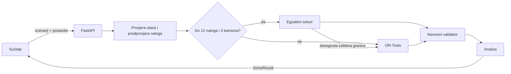

# Upute za korištenje

## 1. Minimum za početak

1. Instaliraj [uv](https://docs.astral.sh/uv/getting-started/installation/) (jednom).
2. U mapi projekta pokreni:
   ```
   uv sync
   uv run uprent serve
   ```
3. Otvori **http://127.0.0.1:8000**.

Plan za podatke iz zadatka izračuna se sam: **182,2 km, svih 10 naloga, dokazano optimalno.** Sve ostalo je opcionalno, a aplikacija sama objašnjava svaki dio (ⓘ uz postavke i kratki opis ispod naslova svake kartice).

## 2. Zaslon na prvi pogled

```
┌──────────────────────────────────────────────────────────────────┐
│ naziv · oznaka statusa plana ·                [Izračunaj plan] [?]│
├──────────────┬───────────────────────────────────────────────────┤
│ POSTAVKE     │ Plan · Karta · Vremenska crta · Analiza · Provjera ·│
│ (tumačenja   │ Ulazni podaci                                       │
│  zadatka, ⓘ) │ ┌ ukupno km ┐ ┌ izvršeno ┐ ┌ korišteni kamioni ┐   │
│              │ ▸ Drugo tumačenje … [Primijeni]                     │
│              │ kartica po kamionu s tablicom koraka                │
│              │ ⚠ upozorenja, kad postoje                          │
└──────────────┴───────────────────────────────────────────────────┘
```

- **Oznaka statusa:** „Dokazano optimalno" (egzaktni solver je pregledao sve dopuštene rasporede) ili „Najbolje pronađeno" (OR-Tools, veći ulazi).
- **Plan se računa sam** kod otvaranja i nakon svake promjene. Dok računa, piše „Računam…", a prethodni rezultat ostaje vidljiv.
- Izbornik **?** sadrži pregled kartica i gumb „Vrati podatke i postavke iz zadatka".

## 3. Postavke

Zadane vrijednosti su najočitije, doslovno tumačenje teksta zadatka.

| Postavka | Zadano | Što mijenja |
|---|---|---|
| Dnevni limit vozača | 9 h | najviše vremena po kamionu u danu |
| U 9 h ulazi i utovar/istovar | isključeno | Isključeno: limit vrijedi samo za vožnju. Uključeno: u limit ulaze i radnje. Na podacima iz zadatka: 182,2 km → 200,1 km. |
| Trajanje utovara / istovara | 20 / 20 min | Vrijeme svake radnje. Za tumačenje „20 min po nalogu" postavi 10 i 10. Može se zadati i za pojedini nalog (Ulazni podaci). |
| Svaki kamion mora voziti | isključeno | Uključeno: svaki kamion dobiva barem jedan nalog kad je to moguće (na podacima iz zadatka 200,1 km). |
| Djelomičan plan | uključeno | Ako sve naloge nije moguće izvršiti, izvrši se najviše što se može, a ostali dobiju upozorenje s razlogom. |
| Cilj | najmanje km | Druga mogućnost: najraniji završetak posljednjeg kamiona (na podacima iz zadatka 284,2 km, svi gotovi za 5 h 45 min). |
| Napredno: solver, vrijeme pretrage, usporedba s OR-Toolsom, početak smjene | auto, 3 s, da, 07:00 | Auto bira egzaktni solver za scenarije do 12 naloga i 3 kamiona. Veće ulaze preuzima OR-Tools, kao i izračune koji dosegnu granicu vremena ili broja stanja. Početak smjene služi samo za satnicu. |

Brzina kamiona (60 km/h) zadaje se po kamionu u kartici Ulazni podaci.

## 4. Ulazni podaci

- Četiri tablice: lokacije (x, y u km), strojevi (masa), kamioni (nosivost, broj mjesta, brzina) i nalozi (stroj, preuzimanje, isporuka te po želji trajanje radnji).
- **Dodaj / obriši** redak, **Vrati podatke iz zadatka**, **Uvezi / izvezi JSON**.
- Greška unosa (npr. nepoznata lokacija) prikazuje se crveno uz polje. Neispravna izmjena se ne računa, a prethodni plan ostaje.
- Primjer za zahtjev 8: dodaj stroj M11 od 12.000 kg i nalog N11 L1 → L3. Plan postaje 10/11, a uz N11 piše da je teži od najveće nosivosti (10.000 kg).

## 5. Čitanje plana

- **Kartice brojki:** ukupni km, izvršeno X/Y naloga i korišteni kamioni.
- **Drugo tumačenje:** ako suprotna vrijednost postavke („U 9 h ulazi utovar/istovar", „Svaki kamion mora voziti") mijenja egzaktni rezultat, traka prikazuje taj rezultat i gumb **Primijeni**. Nakon sporijeg izračuna dodatnu analizu možete pokrenuti na zahtjev.
- **Kartica kamiona:** niz lokacija od baze do baze, km, broj naloga, vožnja i ukupno radno vrijeme, rezerva do limita. Kamion bez naloga ima oznaku „nije korišten" i poveznicu „zašto?".
- **Tablica koraka:** lokacija, radnja (utovar, istovar ili povratak), nalog i stroj, dionica, ukupni km, satnica te teret u kg i broj strojeva **nakon** radnje, s trakom do nosivosti.
- **Upozorenja (zahtjev 8):** žute kartice s razlogom:
  - pretežak stroj;
  - čak i donja granica potrebnog vremena prelazi dnevni limit, računajući najkraće putove preko svih lokacija utovara i istovara;
  - nalog ne stane uz ostale (uz egzaktni solver to je dokazano);
  - OR-Tools ga nije uključio (to nije dokaz).

## 6. Karta i vremenska crta

- **Karta:** koordinatna ravnina u km, jer zadatak ne koristi stvarne ceste. Rute su u boji kamiona, sa strelicama i brojevima koraka; prelazak mišem prikazuje korak.
- **Vremenska crta:** za svaki kamion trake vožnje i radnji, s crtom limita i oznakom na što se limit odnosi.

## 7. Analiza

- **Zašto ovakva raspodjela:** za svaki nalog koliko bi km dodalo prebacivanje na drugi kamion, ili zašto je nemoguće (npr. M08 je teži od nosivosti A).
- **Najtješnja ograničenja:** npr. „Limit vožnje nije aktivan: B vozi 3 h 02 min od 9 h".
- **Osjetljivost:** do koje vrijednosti postavke plan ostaje isti i koji plan dolazi nakon toga.
- **Krivulja km ↔ kraj radnog dana:** svaka točka je raspored koji nijedan drugi ne nadmašuje i u km i u vremenu. Klik na točku prikazuje taj plan.
- **Usporedba scenarija:** šest unaprijed zadanih tumačenja u jednoj tablici, s oznakom pod kojim je tumačenjima svaki plan valjan.

## 8. Provjera

Popis svih pravila koja je neovisni validator provjerio: baza, nosivost, broj strojeva, redoslijed, isti kamion, svaki nalog jednom, vrijeme, dosljednost km, neizvršeni nalozi i svi kamioni. Uz svako je ishod i vrijednost. Ovdje je i usporedba egzaktnog solvera s OR-Toolsom.

## 9. Kako dijelovi rade zajedno



1. Sučelje šalje scenarij (podatke i postavke) na `POST /api/solve`.
2. Provjera ulaza odbija nemoguće podatke s porukom. Predprovjera označi naloge koji se sigurno ne mogu izvršiti.
3. Auto bira solver. Solver vraća samo redoslijed radnji po kamionu.
4. Validator ponovno simulira taj redoslijed te računa kilometre, vrijeme i teret nakon svake radnje. Kršenje obveznog pravila čini plan nevaljanim. Nekorišten kamion uz uključenu postavku „Svaki kamion mora voziti” dobiva zasebnu informativnu napomenu.
5. Analiza dodaje objašnjenja, drugo tumačenje i krivulju.
6. Nakon prikaza valjanog egzaktnog plana sučelje pokreće zaseban izračun OR-Toolsom ako je usporedba uključena. Rezultati se prikazuju na kartici Provjera.

## 10. Naredbeni redak i API

```
uv run uprent solve data/default_scenario.json
uv run uprent solve data/default_scenario.json --json
uv run uprent solve data/default_scenario.json --set limit_includes_handling=true --set load_min=21 --set unload_min=21
uv run uprent solve data/default_scenario.json --solver ortools
uv run uprent compare data/default_scenario.json
```

API dokumentacija je dostupna dok server radi: **http://127.0.0.1:8000/docs**.

## 11. Česta pitanja

- **Zašto kamion A ne vozi?** B stigne sve sam za 3 h 02 min vožnje, a svaki nalog prebačen na A dodao bi najmanje 17,9 km. Ako u 9 h ulazi i utovar/istovar, B bi radio 9 h 42 min, pa A preuzima N03 (200,1 km).
- **Kada piše „Najbolje pronađeno”?** Plan je izračunao OR-Tools. Možete ga odabrati u postavkama. U automatskom načinu preuzima velike scenarije i izračune koji dosegnu granicu egzaktnog solvera.
- **Port 8000 je zauzet:** `uv run uprent serve --port 8010`.
- **Vratiti sve na početak:** izbornik ? → „Vrati podatke i postavke iz zadatka".
